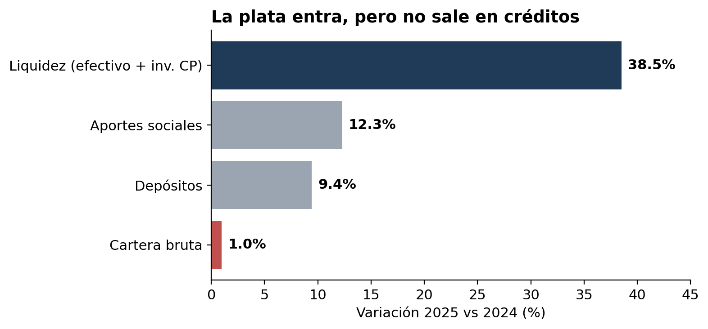
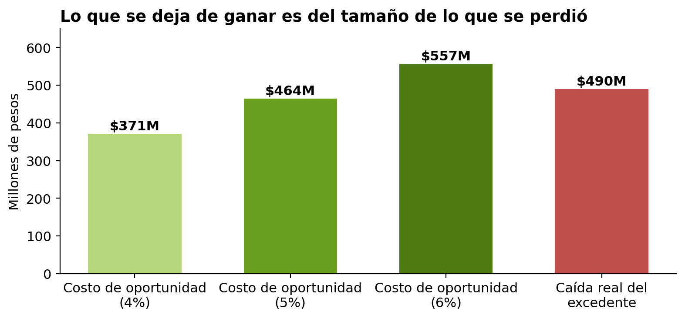
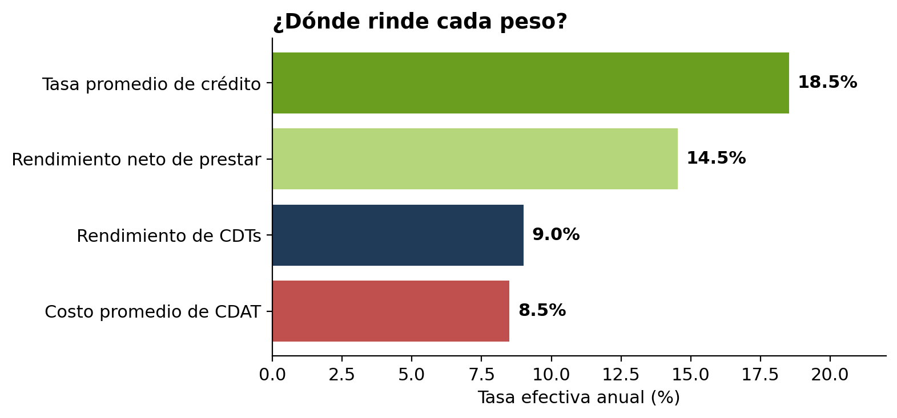
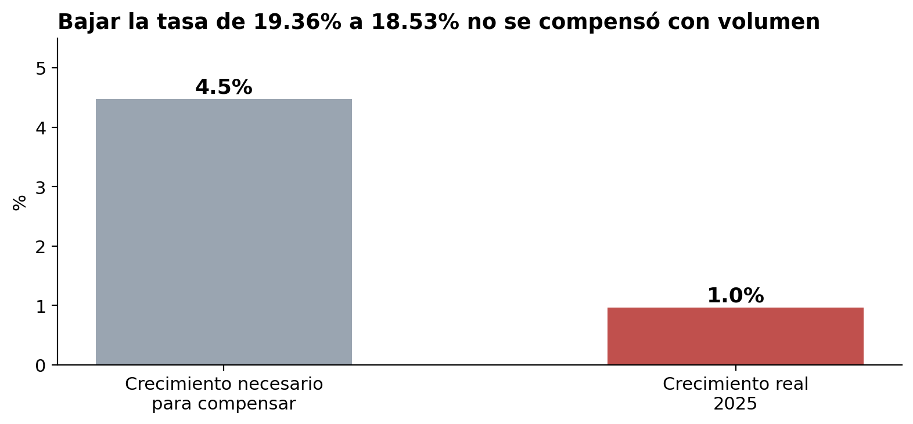
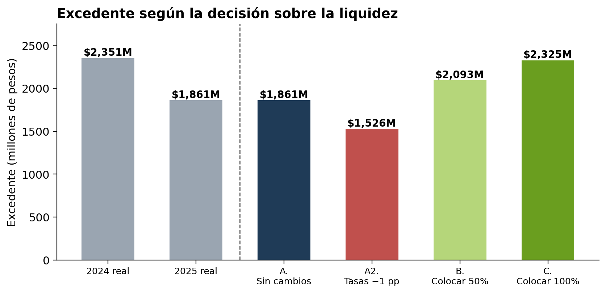

# Liquidez sin colocar: el costo invisible de CESCA en 2025

Análisis de los estados financieros 2025–2024 de **CESCA Cooperativa de Ahorro y Crédito** (Manizales, Caldas) para entender por qué una cooperativa sólida y con liquidez creciente generó 21% menos excedente.

> Análisis independiente elaborado con información pública. No está afiliado ni avalado por CESCA.

📄 **[Ver el informe ejecutivo (PDF, 3 páginas)](informe/Informe_CESCA_2025.pdf)**  ·  📓 **[Ver el notebook con los cálculos](notebooks/analisis_liquidez.ipynb)**

---

## La pregunta

En 2025 CESCA creció en activos (+11%) y mantuvo una solvencia de 21,95%, más del doble del mínimo exigido. Aun así, su excedente cayó de $2.351M a $1.861M. ¿Qué pasó?

## Hallazgos

### 1. La plata entra, pero no sale en créditos

Depósitos y aportes crecieron con fuerza, pero la cartera apenas se movió. La liquidez pasó de ser el 25% al 31% del activo.



### 2. La liquidez sin colocar cuesta entre $370M y $560M al año

Un peso prestado deja 13–15% después de pérdidas y costos; un peso en CDT deja ~9%. Aplicado a los $9.278M en CDTs a más de 90 días, la diferencia es del mismo tamaño que la caída del excedente.



### 3. Captar sin colocar casi no deja margen

CESCA pagó en promedio 8,5% por sus CDAT y los recursos no colocados rinden ~9% en CDTs. Después de GMF, prima de Fogacoop y gasto administrativo, ese margen probablemente es negativo.



### 4. El cuello de botella no es el precio del crédito

Al bajar la tasa de 19,36% a 18,53%, la cartera necesitaba crecer 4,5% para mantener los ingresos. Creció 1,0% y los intereses de cartera cayeron $427M.



### 5. Escenarios 2026

Colocar todo el excedente de liquidez llevaría el excedente cerca del nivel de 2024. Mantener la situación actual con tasas de mercado más bajas lo reduciría.



## Metodología

1. Extracción manual de las cifras de los estados financieros y sus notas a un CSV, con la fuente de cada dato.
2. Recálculo de variaciones e indicadores y validación cruzada entre estados y notas.
3. Estimación del costo de oportunidad con supuestos explícitos y análisis de sensibilidad.
4. Cálculo del punto de equilibrio de la baja de tasa.
5. Construcción de escenarios simples (una variable a la vez).

### Supuestos

| Parámetro | Valor | Criterio |
|---|---|---|
| Rendimiento de CDTs | ~9% e.a. | Tablas de CDT de las Notas 5 y 6 |
| Pérdida esperada del crédito | 2–3% | Castigos y deterioro de capital 2025 |
| Costo operativo marginal | 1–2% | Supuesto del autor |
| Diferencial neto crédito vs. CDT | 4–6 pp | Rango calculado (4,5–6,5) redondeado hacia abajo |

Todos los supuestos están en [`datos/supuestos.csv`](datos/supuestos.csv) y se pueden modificar para recalcular los resultados.

## Limitaciones

- Solo hay dos periodos (2024 y 2025), por lo que no se analizan tendencias de largo plazo.
- La información es agregada: no hay detalle por crédito, agencia o asociado.
- Las tasas son promedios anuales y algunos parámetros son estimaciones.
- Los escenarios son ilustrativos: cambian una variable y mantienen las demás constantes.

## Estructura del repositorio

```
analisis-cesca-2025/
├── README.md
├── datos/
│   ├── cifras_estados_financieros.csv   # cifras extraídas, con su fuente
│   └── supuestos.csv                    # parámetros del modelo
├── notebooks/
│   └── analisis_liquidez.ipynb          # cálculos y gráficas
├── graficas/                            # generadas por el notebook
├── informe/
│   └── Informe_CESCA_2025.pdf           # informe ejecutivo
└── requirements.txt
```

## Cómo reproducirlo

```bash
pip install -r requirements.txt
cd notebooks
jupyter notebook analisis_liquidez.ipynb
```

## Herramientas

Python (pandas, matplotlib), Jupyter Notebook y Word para el informe ejecutivo.

## Fuente

Informe de Gestión CESCA Cooperativa de Ahorro y Crédito, vigencia 2025: estados financieros comparativos, notas a los estados financieros y dictamen del revisor fiscal. [Enlace al informe en el sitio de CESCA]

## Autor

**Anderson Mateo Iglesias Suarez** · Analista de Datos
📧 smateoiglesias@gmail.com · 💼 [LinkedIn](https://www.linkedin.com/in/tu-perfil)
